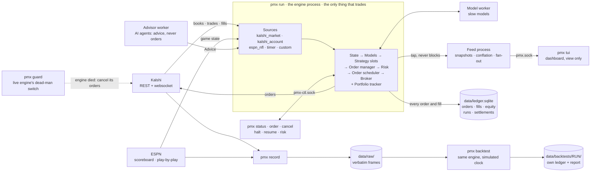
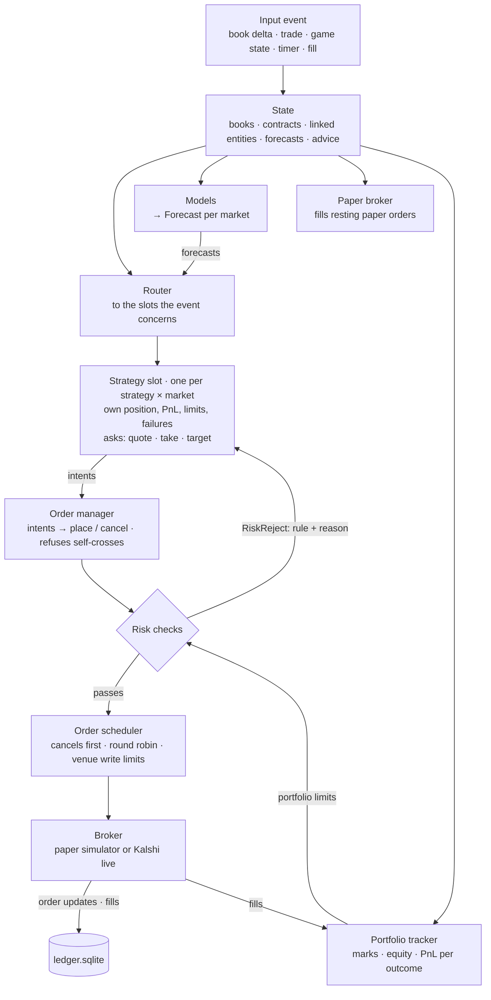

# pmx

A trading system for prediction markets. pmx records market data and outside data (game state, for example), turns it
into fair-value forecasts, runs strategies against it in paper or live mode, enforces risk limits, tracks portfolio
risk and performance, backtests on recorded and historical data, and shows everything in a terminal dashboard.

- **Venues:** Kalshi (REST + websocket), behind a venue interface.
- **Data:** any source as a plugin; Kalshi market data and ESPN NFL game state are included. Everything is recorded
  verbatim and can be replayed.
- **Strategies:** written for one market; the engine runs an isolated copy per market with its own position, PnL,
  limits, and failures. Reference strategies `noop`, `watch`, and `scripted` are included.
- **Execution:** paper broker and live Kalshi broker behind the same interface, layered risk checks, an order
  scheduler within the venue's rate limits, and a watchdog that cancels live orders if the engine dies.
- **Analysis:** portfolio risk by outcome, performance stats with confidence intervals, backtests at book or candle
  fidelity, reports and comparisons.
- **Dashboard:** a Rust terminal UI that attaches to and detaches from the running engine.

## Setup

Requires [uv](https://docs.astral.sh/uv/) and, for the dashboard, Rust. Runs on macOS and Linux (`pmx ops install`
manages launchd agents and is macOS-only).

```sh
uv sync --python 3.13                             # .venv from uv.lock: pmx and the dev tools
ln -s "$PWD/.venv/bin/pmx" ~/.local/bin/pmx       # the `pmx` command, from any directory (~/.local/bin on PATH)
pmx help                                          # every command with a one-line description
pmx help backtest                                 # one command's options (same as pmx backtest -h)
pmx help --all                                    # every command's options
pmx doctor                                        # checks the venv, the TUI build, keys, clock, disk
```

### Kalshi API

Read-only market data works without a key (REST polling). The websocket, account data, and orders need an API key.
Demo (`demo.kalshi.co`, play money, its own sign-up) and prod (`kalshi.com`) are separate accounts with separate keys;
commands take `--env demo|prod` (default: `KALSHI_ENV`, else `demo`).

**Option A: let Kalshi make the key.** On the Kalshi site: Account → Profile → API Keys → Create New API Key. Kalshi
shows a key ID and downloads a private key file. Then:

```sh
pmx setkey --env prod                  # asks for the key ID and the downloaded file
```

**Option B: make the key here** (an Ed25519 key; the private half never leaves this machine):

```sh
pmx keygen --env prod                  # prints a public key: paste it in Kalshi's Create New API Key form
pmx setkey --env prod KEY_ID           # the key ID Kalshi shows for it
```

Either way `setkey` keeps the private key at `~/.kalshi/pmx-<env>.key` (mode 0600), writes the key ID and path to
`.env` (`KALSHI_<ENV>_API_KEY_ID`, `KALSHI_<ENV>_PRIVATE_KEY_PATH`), and runs the check:

```sh
pmx check --env prod                   # auth, REST, websocket
pmx check --env demo --order           # on demo, also places and cancels a 1¢ order
pmx account --env prod                 # balance and venue positions
```

Live orders need a funded balance; Kalshi keeps balances per exchange shard,
and risk checks the balance on the shard the order's market trades on.

## Usage

**Explore** an invented session (fake markets, strategies, and PnL; no account needed):

```sh
pmx up --demo && pmx tui --demo        # q leaves the TUI; pmx down --demo stops the session
```

**Look at markets:**

```sh
pmx markets --series KXNFLGAME --env prod
pmx book TICKER --env prod
pmx tui --env prod                     # live markets in the dashboard, nothing trading
```

**Record** market data and the sources in `config/recorder.toml` (book-fidelity backtests need recorded days):

```sh
pmx record --env prod --series KXNFLGAME
pmx record --counts                    # what was recorded today
```

**Run strategies.** `config/strategies.toml` defines the sources, models, strategies, and risk limits; strategies
trade paper unless marked live:

```sh
pmx config check                       # validate the config and print the plan
pmx up --env prod                      # the engine in the background (pmx run: in the foreground)
pmx tui --env prod                     # Markets · Portfolio · Strategies · Slots · Log
pmx status                             # sources, slots, orders, halts, PnL
pmx positions                          # open positions per slot
pmx risk                               # equity, capital at risk, worst case by outcome, limit usage
pmx perf --strategy ID                 # performance stats and a profitability verdict
pmx down                               # orderly stop: halt, cancel working orders, save
```

**Trade by hand and stop trading** — manual orders go through the same risk checks and ledger as strategies:

```sh
pmx order buy TICKER 5 @ 0.40          # rests a YES bid (paper unless --mode live); --ioc to take
pmx cancel --all
pmx halt [ID | ID/TICKER]              # kill switch: everything, one strategy, or one market's slot
pmx resume [ID | ID/TICKER]
```

**Backtest** recorded days or NFL history through the same config and engine:

```sh
pmx backtest --from DAY [--to DAY]     # recorded days; --from/--to also take times (DAYTHH:MM:SSZ)
pmx backtest --nfl-history --seasons 2025,2026
pmx backtest report RUN                # stats per strategy and market
pmx backtest compare RUN paper:DAY     # a backtest against the live paper ledger
pmx backtest view RUN                  # the run in the dashboard
```

**Trade live.** A strategy trades live only with `mode = "live"` in its config and `pmx run --live`, which also
starts `pmx guard`, a watchdog that cancels the engine's orders if it dies. Prod also requires typing `prod` at
start. `pmx run --env demo --live` runs against Kalshi's demo exchange.

Running unattended (launchd agents, backups, alerts): [`docs/runbooks/operations.md`](docs/runbooks/operations.md).
Recording: [`docs/runbooks/recording.md`](docs/runbooks/recording.md).

## How it works

Five kinds of plugin, registered by `kind` and wired together in `config/strategies.toml`:

| Plugin | Does | Examples |
|---|---|---|
| **Source** | brings data in; recorded raw | Kalshi books and trades, ESPN game state, a timer |
| **Linker** | says what a market is about | `KXNFLGAME-26OCT18HOUJAC-HOU` → the HOU @ JAX game |
| **Model** | turns data into fair probabilities; several run side by side | `espn_wp`, `market_mid` |
| **Strategy** | trades one market (or one group of related markets) | `noop`, `watch`, `scripted` |
| **Advisor** | slow reasoning outside the engine loop (an AI agent, or you via `pmx advise`); sends advice, never orders | `scripted_advice` |

Live trading, paper trading, and backtests run the same engine; only the clock, the data source, and the broker
differ. Money is integer (prices in 1e-4 $, cash in 1e-6 $), every price and position is in YES terms, and raw data
is stored verbatim so everything derived from it can be rebuilt.

### The system

Processes, what they talk over, and where data lands. Only the engine trades; the feed, the TUI, and the recorder only
watch, and nothing they do can slow it down.



### One event, one order

Every input runs this path to completion before the next one starts, so live, paper and backtests make the same
decisions from the same data. A strategy only asks; the platform decides what reaches the venue.



Risk checks every new order in this order, and the first failure rejects it:

1. **Halts:** the kill switch (`pmx halt`) for everything, one strategy, or one slot.
2. **The market:** it must be known and open, and the slot must be past its warm-up and inside its trading windows.
3. **Freshness:** the book, the model's forecast, and the strategy's inputs must be recent enough.
4. **Sanity:** the price must be within the price band of fair or mid, and the order size under `max_order_qty`.
5. Orders that only reduce a position are allowed from here. Anything that adds exposure goes on:
6. **Slot and strategy limits:** `max_position`, `max_loss`, `max_open_orders`.
7. **Portfolio limits:** max loss, capital at risk, worst case across outcomes, risk per entity (e.g. one game), drawdown.
8. **Cash:** enough balance on the market's exchange shard.

Before risk, the order manager refuses an order that would trade against one of our own resting orders.

### Where things live

| Path | What |
|---|---|
| `config/strategies.toml` | what `pmx run` runs: sources, models, strategies, risk limits (`config/recorder.toml`: `pmx record`) |
| `data/ledger.sqlite` | the books of record, paper and live kept apart: orders, fills (with fair / mid / markouts), equity snapshots, settlements, runs (git sha, config), slot checkpoints. Positions are derived from fills, never stored |
| `data/raw/` | verbatim venue and source frames (zstd), plus connect / gap / sleep records; everything else can be rebuilt from it |
| `data/parquet/` | research tables from `pmx compact` |
| `data/backtests/RUN/` | a backtest's own ledger, config copy, summary, report |
| `data/pmx.sock` · `data/pmx-ctl.sock` | the viewer feed and the control channel of the running engine |
| `data/HALT` · `data/health.json` · `data/logs/` | the kill-switch file, the engine's health (for `pmx status` when it's down, and alerts), logs |
| `~/.kalshi/` · `.env` | Kalshi private keys and key IDs |

## Writing a strategy

A strategy sees one market through `m` and asks for orders; risk, scheduling, fills, and the ledger are the
platform's:

```python
import msgspec
from pmx.core.units import ONE_DOLLAR, parse_qty
from pmx.plugins import strategy
from pmx.strategies.base import MarketContext, Strategy

@strategy("edge_taker")
class EdgeTaker(Strategy):
    class Params(msgspec.Struct, frozen=True):
        min_edge: float = 0.04
        size: str = "5"

    def on_forecast(self, f, m: MarketContext) -> None:
        ask = m.book.best_ask() if m.book else None
        fair = round(f.p * ONE_DOLLAR)
        if ask and fair - ask[0] - m.taker_fee(ask[0]) >= self.p.min_edge * ONE_DOLLAR:
            m.take("bid", limit=ask[0], qty=parse_qty(self.p.size))
```

Test it with scripted scenarios before any data (`pmx.testing.Scenario`), then backtest, paper, live — the same
class at every step. The full recipe, and how to add sources, models, and advisors: [`docs/GUIDE.md`](docs/GUIDE.md).

## Layout

```
src/pmx/
  core/         units, types, order book, fees          engine/      dispatcher, state, slots, config, run
  connectors/   venues (kalshi/)                        strategies/  base + reference strategies
  sources/      kalshi, espn_nfl, timer                 execution/   risk, orders, scheduler, paper, live broker
  models/       model runtime, market_mid, espn_wp      portfolio/   positions, scenarios, limits
  advisors/     advisor worker + reference              analytics/   stats, breakdowns, verdict
  recorder/     raw log, replay, compact, retention     backtest/    runner, raw + NFL-history sources, reports
  sports/nfl/   the NFL domain (teams, ESPN, linker)    feed/        feed protocol + process for viewers
  ledger/       SQLite ledger (positions derived)       control/ ops/ cli/   control socket, guard + ops, CLI
  testing/      the strategy scenario kit               bench/ harness/      load benchmarks, model scorecards
tui/            Rust (ratatui) dashboard — a pure view over the feed socket
config/         strategies.toml (pmx run), recorder.toml (pmx record), scripts/
docs/           architecture, guide, runbooks
data/           recordings, ledgers, backtests, logs (git-ignored)
```

## Development

```sh
uv run pytest                          # the test suite, offline
uv run pytest -m slow                  # performance budgets under load
uv run ruff check src tests
(cd tui && cargo test && cargo clippy --all-targets && cargo fmt --check)
```

CI (`.github/workflows/ci.yml`) runs the test suite, ruff, and the TUI checks on every push.

**Docs:** [`docs/ARCHITECTURE.md`](docs/ARCHITECTURE.md) (components, interface contracts, invariants),
[`docs/GUIDE.md`](docs/GUIDE.md) (adding sources, models, strategies, advisors),
[`docs/runbooks/`](docs/runbooks/) (operations),
[`CLAUDE.md`](CLAUDE.md) (every command and the design rules).
